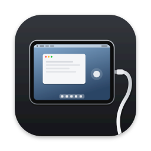

<p align="center"></p>

<h1 align="center">WiredPad</h1>

<p align="center"><a href="README.md">English</a> | <b>日本語</b></p>

WiredPadは、iPadをmacOS 27のタッチスクリーンとして使うためのアプリです。macOS 27はタッチスクリーンからの直接タッチをAppKitアプリへ届けられます。WiredPadはUSBまたはWi‑FiでつないだiPadを、そのタッチスクリーンにします。iPadに触れた指は、マウスのクリックではなく、最大10点のネイティブなマルチタッチとしてMacのアプリに届きます。

そのために、iPadの実解像度に合わせた仮想ディスプレイをMacに作り、HEVCまたはH.264のハードウェア処理でiPadへ映像を送ります。iPadのタッチは、HIDDriverKit拡張がその画面に結び付いたデジタイザとしてMacへ返します。iPad本体の音量ボタンもMacの音量キーとして使えます。

このリポジトリはソースコードです。インストール用の完成品ではありません。macOS 27.2のMacとiPadOS 26を搭載した第8世代iPadで動作を確認しました。他の機種やOSでは未検証です。

## 動作確認済みの機能

- 署名済みHIDDriverKit拡張を有効にした場合の、仮想画面上での最大10点のAppKit直接タッチ。
- USBまたはWi‑Fi経由の映像転送。VideoToolboxによるハードウェア圧縮・復号、HiDPI、iPadの画面更新上限への対応。
- iPadの物理音量ボタンによるMac音量操作。
- USBを優先し、ネットワーク経路は有線LAN・Wi‑Fi LAN・AWDL（Appleのピアツーピア Wi‑Fi）のうち1本を待機させます。各リンクは100msごとに応答を確認し、応答の良いリンクを使います。Wi‑Fi LANとAWDLに決まった優先順位はなく、10分ごとと、使用中の経路が普段より大きく遅くなったときに、もう一方を10秒間試して安定しているほうを残します。AWDLは動いている間Wi‑Fiネットワークを遅くするので、Wi‑Fi LANはAWDLが止まっているときに測った値で判断します。Wi‑Fi Awareは今のところiPad側だけの対応で、Mac以外のホスト向けです。macOSにはWi‑Fi AwareのAPIがなく、iPad側にもWi‑Fi Awareのエンタイトルメントと対応ハードウェアが必要です。USB接続中も裏でWi‑Fiの経路をつないでおくので、ケーブルを抜き差ししてもフレームを落とさずに切り替わります。
- ペアリング。USBでつないだiPadは自動でペアリングされます。Wi‑Fiだけで使う場合は、メニューバーの「近くのiPad」からiPadを選び、両方の画面に同じ6桁の番号が出ていることを確認します。
- iPadのロック解除後とUSB抜き差し後の自動映像復帰。
- 日本語・英語のUI。ほかの言語は`Resources/<language>.lproj`に追加できます。

## 重要な制約

- 仮想画面の生成とUUID取得に、非公開の`CGVirtualDisplay`と`CGSCopyDisplayUUID`を使います。OS更新で動かなくなる可能性があります。[Appleは配布申請するアプリに文書化されたAPIの使用を求めています](https://developer.apple.com/support/terms/apple-developer-program-license-agreement/)。これは開発用の試作です。
- 映像取得はScreenCaptureKitを使用します。macOSの画面収録許可が必要で、接続中は画面共有の表示が出ます。
- 直接タッチには、Appleから付与されたHID Virtual DeviceとDriverKitの権限、署名証明書、対応するプロビジョニングプロファイルが必要です。リポジトリ内のエンタイトルメントファイルだけでは権限を得られません。
- 署名済みアプリやプロビジョニングプロファイルは含めていません。iPad版は開発用にXcodeから入れます。
- Wi‑Fiの通信は、ペアリングしたMacごとに別の事前共有鍵を使うTLSで暗号化します。ペアリング済みのMac以外は接続できません。USB用のポート41027はUSBトンネル経由の接続だけを受け付けます。ペアリングはiPadが待機画面を表示している間だけ受け付け、失敗が続くと一時停止します。鍵は各端末のキーチェーンに保存し、同期しません。第三者によるセキュリティ監査は受けていません。
- USB接続中も映像をWi‑Fiで並行して送るため、Wi‑Fiの帯域とバッテリーを多く使います。Wi‑Fiが弱いと、USBから切り替わる瞬間に数フレーム落ちることがあります。
- iPadの音量ボタンは音量値の変化と`MPVolumeView`で検出します。押下後と接続終了時にiPad音量を戻します。iPadOS更新後は再確認が必要です。

## ソースからビルド

macOS 27.2とiPadOSのSDKを備えたXcode、[XcodeGen](https://github.com/yonaskolb/XcodeGen)、Apple Developerのチームと開発用権限が必要です。[DriverKit権限の申請方法](https://developer.apple.com/documentation/driverkit/requesting-entitlements-for-driverkit-development)を参照してください。MacホストのApp IDにはHID Virtual DeviceとSystem Extension、DriverKit用App IDにはDriverKit・HID EventService・Transport HIDの権限が必要です。iPad版のApp IDも登録してください。

同梱するプロジェクトの`com.example.wiredpad`は署名に使わない仮IDです。共通ビルド設定`WIREPAD_BUNDLE_PREFIX`へ自分が管理する接頭辞（例: `com.yourname.wiredpad`）を指定すると、Mac・iPad・DriverKitのIDがそれぞれ`<prefix>.WiredPadMac`、`<prefix>.WiredPadPad`、`<prefix>.WiredPadTouchDriver`になります。個人のApp IDをリポジトリに書く必要はありません。登録済みIDに独自の接尾辞がある場合、ビルドスクリプトへ`WIREPAD_HOST_BUNDLE_ID`と`WIREPAD_DRIVER_BUNDLE_ID`を渡せます。ホストとドライバでは`WiredPadMac`と`WiredPadTouchDriver`より後の接尾辞を一致させてください。

1. `xcodegen generate --spec project.yml`と`xcodegen generate --spec DriverKitPrototype/project.yml`でXcodeプロジェクトを生成します。署名なしビルドや参照用の汎用プロジェクトも同梱しています。
2. 自分の署名設定でMacアプリとドライバをビルドします。

   ```sh
   export WIREPAD_BUNDLE_PREFIX=com.yourname.wiredpad
   export WIREPAD_TEAM_ID=YOUR_TEAM_ID
   export WIREPAD_DRIVER_PROFILE='Your DriverKit Development Profile'
   export WIREPAD_HOST_PROFILE='Your Mac Host Development Profile'
   export WIREPAD_SIGNING_IDENTITY='Apple Development: Your Name (TEAM_ID)'
   ./DriverKitPrototype/build-bundled-app.sh
   ```

3. `WiredPad.xcodeproj`で`WiredPadPad`スキームと接続したiPadを選び、ビルド設定の`CODE_SIGNING_ALLOWED=YES`、自分のTeam、Mac版と同じ`WIREPAD_BUNDLE_PREFIX`を設定して実行します。iPadの登録済みIDに独自の接尾辞がある場合だけ`PRODUCT_BUNDLE_IDENTIFIER`をそのIDで上書きします。Xcodeが求めたらiPadの開発者モードを有効にします。
4. スクリプトが表示した署名済みMacアプリを開き、初回だけ「診断と設定」からタッチドライバを有効にします。必要ならシステム設定で承認してください。iPadアプリを開いてUSB接続し、「このコンピュータを信頼」を許可します。Macアプリが自動で接続します。画面収録を求められたら許可します。

Appleアカウント不要のコンパイル確認:

```sh
xcodebuild -project WiredPad.xcodeproj -scheme WiredPadMac -destination 'generic/platform=macOS' CODE_SIGNING_ALLOWED=NO build
xcodebuild -project WiredPad.xcodeproj -scheme WiredPadPad -destination 'generic/platform=iOS' CODE_SIGNING_ALLOWED=NO build
xcodebuild -project DriverKitPrototype/WiredPadDriverPrototype.xcodeproj -scheme WiredPadTouchDriver -destination 'generic/platform=DriverKit' CODE_SIGNING_ALLOWED=NO build
```

## 仕組み

Mac側が仮想ディスプレイを作り、その画面だけをScreenCaptureKitで取得します。VideoToolboxで圧縮した映像を`usbmuxd`のUSBトンネルまたはWi‑Fiで送り、iPad側が復号・表示します。iPadは同じ経路でタッチ位置と音量操作を返します。すべてのメッセージに番号を付け、相手が受信を確認するまで保持します。受信側は重複を捨てて順番を戻すので、USBとWi‑Fiの間を移っても欠けや重複は起きません。CoreHIDの仮想タッチ機器とConsumer Control機器を作り、DriverKit拡張がタッチイベントを仮想画面UUIDに関連付けます。

[DriverKitの詳細](DriverKitPrototype/README.md)と[Sidecar入力経路の調査記録](SIDECAR_ANALYSIS.md)も参照できます。調査記録は観測結果であり、Appleが保証するAPI仕様ではありません。

## ライセンス

[MIT](LICENSE)。Appleのフレームワーク、SDK、システムコンポーネントは含みません。
