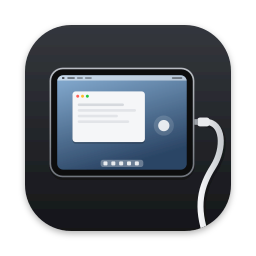

<p align="center"></p>

<h1 align="center">WiredPad</h1>

<p align="center"><b>English</b> | <a href="README.ja.md">日本語</a></p>

WiredPad lets you use an iPad as a touch screen for macOS 27. macOS 27 can deliver direct touches from a touch screen to AppKit apps, and WiredPad turns a USB-connected iPad into that touch screen. Your fingers on the iPad reach Mac apps as native multi-touch, up to ten contacts at once, not as mouse clicks.

To make that possible, WiredPad creates a virtual Mac display at the iPad's native resolution and streams it to the iPad with hardware HEVC or H.264. A HIDDriverKit extension sends the iPad's touches back as a digitizer attached to that display. The iPad's volume buttons also work as Mac volume keys.

This repository contains source code, not a ready-to-install release. The display and native touch path has been verified on one macOS 27.2 Mac with an eighth-generation iPad running iPadOS 26. Other Macs, iPads, OS versions, and audio devices have not been tested.

## What works

- Up to ten native AppKit direct touches on the virtual display when the signed HIDDriverKit extension is active.
- USB video with VideoToolbox hardware encoding and decoding, HiDPI, and the iPad's reported display refresh rate.
- Mac volume control using the iPad's physical volume buttons.
- Automatic video reconnection after locking the iPad or unplugging and reconnecting USB.
- English and Japanese app UI. Add another language under `Resources/<language>.lproj`.

## Important limitations

- `CGVirtualDisplay` and `CGSCopyDisplayUUID` are private macOS APIs. They can change or disappear in a system update. [Apple requires documented APIs for apps submitted for distribution](https://developer.apple.com/support/terms/apple-developer-program-license-agreement/); this project is a development prototype, not an App Store submission.
- Video capture uses ScreenCaptureKit. macOS requires Screen Recording permission and shows its screen-sharing indicator while streaming.
- Native touch needs Apple-granted HID Virtual Device and DriverKit entitlements, signing certificates, and matching provisioning profiles. Your own App IDs and profiles are required. The entitlements in this repository do not grant access by themselves.
- No signed binaries or provisioning profiles are included. The iPad app is installed through Xcode for development.
- The iPad listens on TCP port 41027 for the USB tunnel. The listener may also be reachable from the iPad's local network. The protocol does not add its own authentication or encryption; use it only on trusted networks and with devices you trust. Network isolation and pairing are not implemented yet.
- Physical volume-button detection on iPad uses observed system-volume changes and `MPVolumeView`. It restores the iPad volume after each press and when the session ends. Recheck this behavior after iPadOS updates.

## Build from source

You need Xcode with the macOS 27.2 and iPadOS SDKs, [XcodeGen](https://github.com/yonaskolb/XcodeGen), an Apple Developer team, and the required development entitlements. [Apple explains how to request DriverKit entitlements](https://developer.apple.com/documentation/driverkit/requesting-entitlements-for-driverkit-development). The Mac host App ID needs HID Virtual Device and System Extension; the DriverKit App ID needs DriverKit, HID EventService, and Transport HID. Register an iPad App ID for development signing as well.

The checked-in projects use `com.example.wiredpad` as a non-signable placeholder. Set the shared `WIREPAD_BUNDLE_PREFIX` build setting to a prefix you control, such as `com.yourname.wiredpad`. Xcode then derives `<prefix>.WiredPadMac`, `<prefix>.WiredPadPad`, and `<prefix>.WiredPadTouchDriver`; no tracked source file needs a personal App ID. If your registered IDs have another suffix, set `WIREPAD_HOST_BUNDLE_ID` and `WIREPAD_DRIVER_BUNDLE_ID` for the script, and use the matching iPad ID in Xcode. The host and driver IDs must share the same suffix after `WiredPadMac` and `WiredPadTouchDriver`.

1. Generate the Xcode projects: `xcodegen generate --spec project.yml` and `xcodegen generate --spec DriverKitPrototype/project.yml`. Generated generic projects are also checked in for browsing and unsigned builds.
2. Build the Mac app and embedded driver with your own signing values:

   ```sh
   export WIREPAD_BUNDLE_PREFIX=com.yourname.wiredpad
   export WIREPAD_TEAM_ID=YOUR_TEAM_ID
   export WIREPAD_DRIVER_PROFILE='Your DriverKit Development Profile'
   export WIREPAD_HOST_PROFILE='Your Mac Host Development Profile'
   export WIREPAD_SIGNING_IDENTITY='Apple Development: Your Name (TEAM_ID)'
   ./DriverKitPrototype/build-bundled-app.sh
   ```

3. Open `WiredPad.xcodeproj`, select the `WiredPadPad` scheme and your connected iPad, then set `CODE_SIGNING_ALLOWED=YES`, your team, and `WIREPAD_BUNDLE_PREFIX` to the same prefix used for the Mac build. Build and run. If your registered iPad ID has a different suffix, override `PRODUCT_BUNDLE_IDENTIFIER` with that exact ID. Enable Developer Mode on the iPad if Xcode asks.
4. Run the signed Mac app printed by the script. Activate the touch driver once from **Diagnostics & Settings** and approve it in System Settings if prompted. Open the iPad app, connect USB, and trust the Mac. The Mac app connects automatically. Allow Screen Recording when prompted.

For compile-only checks that require no Apple account:

```sh
xcodebuild -project WiredPad.xcodeproj -scheme WiredPadMac -destination 'generic/platform=macOS' CODE_SIGNING_ALLOWED=NO build
xcodebuild -project WiredPad.xcodeproj -scheme WiredPadPad -destination 'generic/platform=iOS' CODE_SIGNING_ALLOWED=NO build
xcodebuild -project DriverKitPrototype/WiredPadDriverPrototype.xcodeproj -scheme WiredPadTouchDriver -destination 'generic/platform=DriverKit' CODE_SIGNING_ALLOWED=NO build
```

## How it works

The Mac app creates a virtual display and captures only that display with ScreenCaptureKit. VideoToolbox encodes frames for a USB tunnel through `usbmuxd`; the iPad app decodes and presents them. The iPad sends touch coordinates and volume steps back over the same connection. CoreHID creates virtual touch and Consumer Control devices; the DriverKit extension attaches the touch service to the virtual display's UUID.

See [DriverKit details](DriverKitPrototype/README.md) and the [experimental Sidecar investigation](SIDECAR_ANALYSIS.md). That investigation records observations, not a supported Apple API contract.

## License

[MIT](LICENSE). Apple frameworks, SDKs, and system components are not included.
